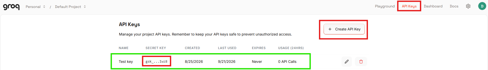
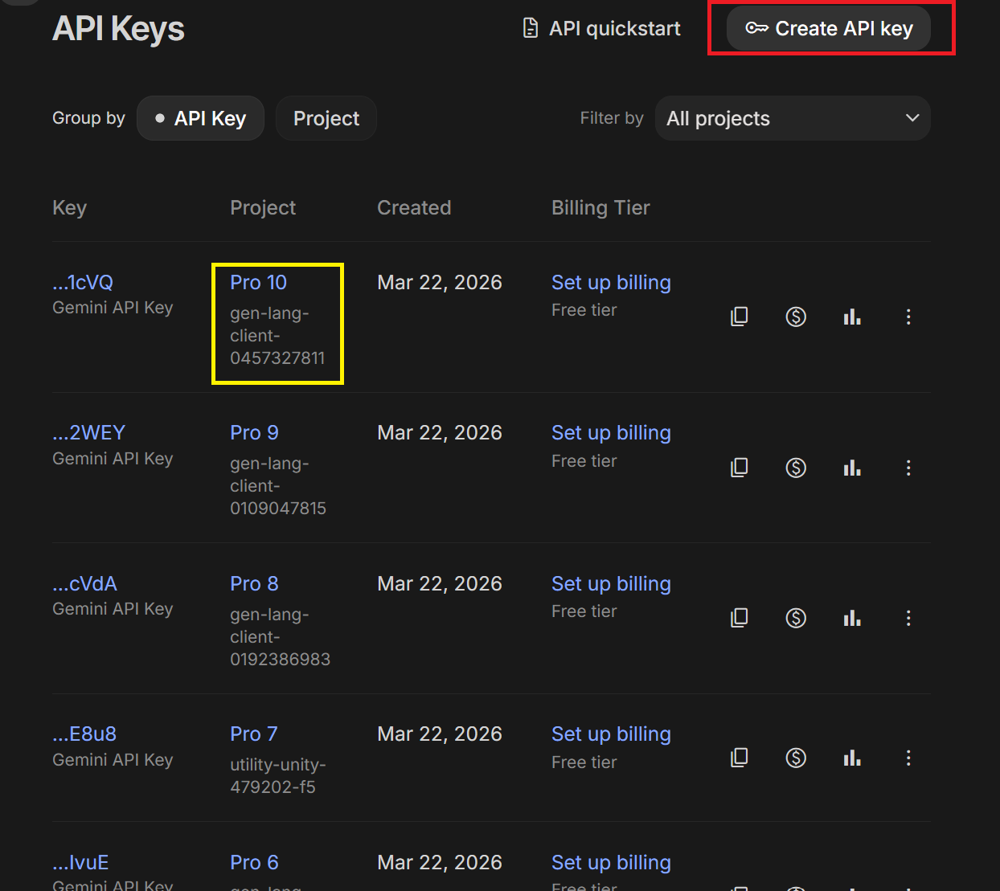
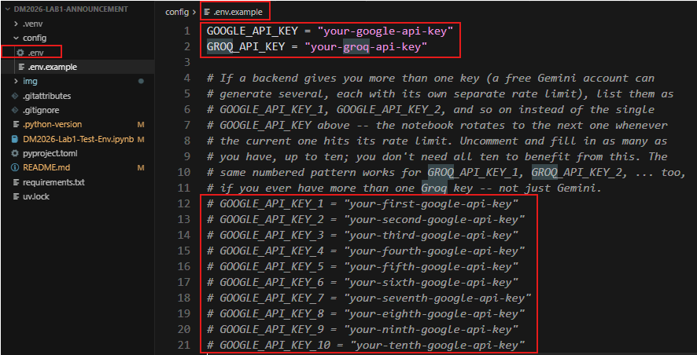
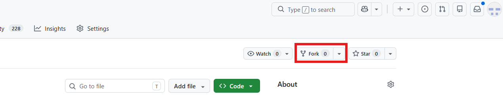
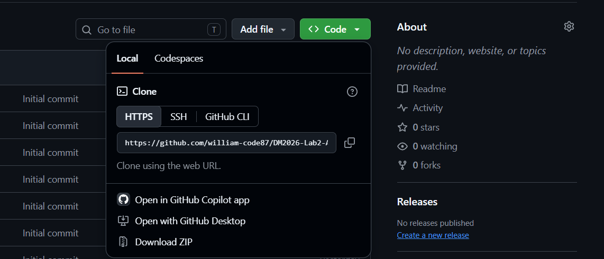

# [ISA5810 DM2026] Lab 2 - Environment Setup

Hi everyone,

A printable version of this guide is available in [DM2026-Lab2-Environment-Setup.pdf](DM2026-Lab2-Environment-Setup.pdf).

The Lab 2 materials are scheduled for release on **October 26**. Check NTU COOL for the release time and repository link.

The Lab tutorial videos will be launched on the [YouTube Channel](https://www.youtube.com/@NTHU_ISA5810_DataMining) before the lab session.

We strongly recommend setting up the environment on your personal laptop **before** the lab session so you can follow along smoothly. If you run into issues, email the TAs or attend TA sessions on weekdays.

This guide has **two parts**:

| Part | When | Where you work |
|------|------|----------------|
| **Part A — Environment check** | **Before the lab** | This Lab 2 setup repository |
| **Part B — Lab work & submission** | **After** the main lab repo is announced | Your fork of **DM2026-Lab2-Exercise** (main lab repo) |

**Where to run the steps:** Do Part A in this setup repository. Once **DM2026-Lab2-Exercise** is available, repeat the environment steps in that repository's root, then continue with Part B. The setup and exercise repositories each have their own `.venv/` and `config/.env`.

**How to run the lab:** **Local setup only** on your laptop with `uv` + Jupyter or VS Code/Cursor/Antigravity. The agentic notebooks require local Jupyter (chat widgets do not work in cloud notebook runtimes).

---

## System requirements

- **Git** and a **GitHub** account. [Tutorial on Git, GitHub and GitHub Desktop](https://youtu.be/8Dd7KRpKeaE?si=rFDI-PHYcDc5jWAn)
- **uv** (installs and manages **Python 3.11** and the project virtual environment)
- **Jupyter** (installed by `uv sync`; use VS Code/Cursor/Antigravity or `jupyter lab` in the browser). **IMPORTANT NOTE:** Using `Jupyter Lab` for the `Agentic Section` of the lab is extremely recommended over some bugs that have been observed with VS Code / Cursor / Antigravity when running the widget to chat with the agent.
- [VS Code](https://code.visualstudio.com/download?_exp_download=fb315fc982), [Cursor](https://cursor.com/download), or [Antigravity](https://antigravity.google/download/) (optional but convenient). Click in the links to download and install the software.

The course targets **Python 3.11** (any patch release — the exact build depends on your OS; see `uv python list`). The announcement repo includes `pyproject.toml`, `uv.lock`, `requirements.txt`, and `.python-version` (`3.11`) so **package** versions match ours; you do not need to match a specific patch number.

---

# Part A — Environment check (DM2026-Lab2-Announcement)

Do this in the **announcement** repo first, even before the main lab materials are released.

## A1. GitHub account and Git

Sign up: [https://github.com/](https://github.com/)

Install Git:

- **Windows:** [https://gitforwindows.org/](https://gitforwindows.org/)
- **Linux:** `sudo apt install git-all`
- **macOS:** `brew install git`

Verify and configure (use your GitHub username and email):

```bash
git --version
git config --global user.name "YOUR_USERNAME"
git config --global user.email "your_email@example.com"
```


If you prefer a GUI (Graphic User Interface), [GitHub Desktop](https://desktop.github.com/) works too. [Check the GitHub Desktop tutorial in this video](https://youtu.be/8Dd7KRpKeaE?si=rFDI-PHYcDc5jWAn)

## A2. Install uv

In Terminal or PowerShell:

```bash
pip install uv
uv --version
```

On Windows you can also use the installer from [https://docs.astral.sh/uv/getting-started/installation/](https://docs.astral.sh/uv/getting-started/installation/).

## A3. Clone the announcement repo

Choose a folder for course work, then clone the **setup** repository (not the main lab repo yet):

```bash
cd <yourpath>
mkdir DM2026Labs
cd DM2026Labs
git clone <Lab-2-setup-repository-URL-from-NTU-COOL>
cd DM2026-Lab2-Announcement
```


## A4. Python 3.11 and dependencies

From the **root** of `DM2026-Lab2-Announcement` (where `pyproject.toml`, `uv.lock`, and `.python-version` live):

Install a **3.11** interpreter once (uv downloads and manages it; the patch version is chosen for your platform):

```bash
uv python install 3.11
```

To see which 3.11 builds uv can install on your machine:

```bash
uv python list | findstr 3.11
```

On macOS/Linux, use `grep` instead of `findstr`:

```bash
uv python list | grep 3.11
```


Create the virtual environment and install all packages at the pinned versions:

```bash
uv sync --locked --python 3.11
```

`uv sync --locked --python 3.11` reads `.python-version` (`3.11`) and uses the 3.11 interpreter you installed above. This creates `.venv` in the project folder and installs everything from `uv.lock`. **Let it finish with no errors** before opening any notebook. A partial install often breaks later notebooks (especially `ipywidgets` for the agent chat).


**Without uv (pip fallback only):** use any **Python 3.11.x** on your PATH, then from the repo root:

```bash
pip install -r requirements.txt
```

**Verify Python version:**

```bash
uv run python --version
```

Expected: `Python 3.11.x` (the patch number may differ from classmates on another OS — that is fine). It must **not** be 3.10 or 3.12+.

## A5. API keys (Groq and Google Gemini)

The agentic part of Lab 2 needs at least **one** LLM provider; we recommend **both** Groq and Gemini so you can use multi-provider fallback in the main repo (see its `README.md` later).

Check each provider's current account and pricing terms before creating a key.

### Groq (recommended primary)

1. Go to [console.groq.com/keys](https://console.groq.com/keys), sign in, and click **Create API Key**.
2. Copy the key immediately — Groq only shows the full key once.
3. **One Groq key is enough.** Extra Groq keys under the same account do **not** increase your quota.



### Google Gemini

1. Go to [aistudio.google.com](https://aistudio.google.com), sign in with a Google account.
2. Click **Get API key** (upper right), then **Create API key**.
3. Optional: create keys in **separate Google Cloud projects** (`Pro 1`, `Pro 2`, …) if you want multiple keys for rotation later (`GOOGLE_API_KEY_1`, `_2`, … in `.env`).



### Create `config/.env`

From the repo root:

**macOS / Linux:**

```bash
cp config/.env.example config/.env
```

**Windows (Command Prompt):**

```bat
copy config\.env.example config\.env
```

Edit `config/.env` and paste your keys (replace the placeholder text):

```env
GROQ_API_KEY="your-actual-groq-key"
GOOGLE_API_KEY="your-actual-google-key"
```

Do **not** commit `config/.env` or share keys publicly.



## A6. Register the Jupyter kernel

Still in the announcement repo root:

```bash
uv run python -m ipykernel install --user --name=dm2026-lab2 --display-name "Python (dm2026-lab2)"
```


## A7. Open notebooks locally

### VS Code / Cursor / Antigravity

**IMPORTANT NOTE:** These programs are not so recommended due to some bugs observed in some environments when testing the Agent Chat Widget in the jupyter notebook, so it might also fail in your machine. You can try to use them, but it is under your own risk. `Jupyter Lab` has not presented any issues with the widget, so it is recommended to use it over this.

Open the folder of the repository from the `VS Code / Cursor / Antigravity` UI or execute the following commands in the terminal:

```bash
cd <path-to-DM2026-Lab2-Announcement>
code .
```

Open **`DM2026-Lab2-Test-Env.ipynb`** and choose kernel **Python (dm2026-lab2)** in the top-right corner.


### JupyterLab in the browser (recommended over classic Notebook for widgets)

**IMPORTANT NOTE:** Using `Jupyter Lab` for the `Agentic Section` of the lab is extremely recommended over some bugs that have been observed with VS Code / Cursor / Antigravity when running the widget to chat with the agent.

```bash
cd <path-to-DM2026-Lab2-Announcement>
uv run --locked jupyter lab
```


Open **`DM2026-Lab2-Test-Env.ipynb`** and select **Python (dm2026-lab2)** as the kernel.


## A8. Test your environment

Open **`DM2026-Lab2-Test-Env.ipynb`**, run **all cells** in order, and fix any errors before the lab session.

The notebook checks:

- Python 3.11 and imports for the Lab 2 pipeline, embeddings, LLM backends, and widgets
- the supplied SemEval files when run from the exercise repository
- Groq and/or Gemini API connectivity using `config/.env`
- the local Jupyter chat-widget layout

In this setup repository the SemEval check is skipped because the dataset is supplied in the exercise repository. After the exercise repository is released, run the environment test there using that repository's environment.

## Troubleshooting (Part A)

- **`uv sync` fails:** read the error, ensure you are in the repo root, run `uv python install 3.11` first, then `uv sync` again; try `uv lock` only if a TA tells you to — normally use the provided `uv.lock` as-is.
- **Wrong Python version:** run `uv python install 3.11`, delete `.venv` if needed, then `uv sync` from the repo root.
- **Wrong kernel:** the notebook must use **Python (dm2026-lab2)** from this project’s `.venv` (`uv run --locked jupyter lab` or VS Code with that interpreter).
- **Chat widget frozen later in the lab:** re-run `uv sync --locked --python 3.11` in the **same** repo you use for notebooks; check `ipywidgets` is installed.
- **An import fails:** run `uv sync --locked --python 3.11` in the current repository and make sure the notebook kernel uses its `.venv`.
- **API tests fail:** check `config/.env`, no placeholder text left, keys not expired; try the other provider.

Ask classmates or TAs before the lab if you are stuck.

Best regards,  
The TAs

---

# Part B - After DM2026-Lab2-Exercise is released

Repeat the environment steps in your fork of the **Lab 2 exercise repository**. It has its own dependencies and local environment. The exercise materials are scheduled for release on **October 26**; use the repository link announced on NTU COOL.

## B1. Fork and clone the exercise repository

A **fork** is your own copy of the exercise repository on GitHub. A **clone** downloads that repository to your laptop so you can work on it locally.

1. Open the **DM2026-Lab2-Exercise** repository link announced on NTU COOL and sign in to GitHub.
2. Click **Fork** in the upper-right corner of the repository page.
3. Select your GitHub account as **Owner**, keep the repository name `DM2026-Lab2-Exercise`, and click **Create fork**.
4. On your fork's page, check that the repository belongs to **your GitHub username**. Click **Code → HTTPS** and copy the URL.
5. Open Terminal or PowerShell in your course-work folder and clone your fork. Replace `YOUR_USERNAME` below with your GitHub username:

```bash
git clone https://github.com/YOUR_USERNAME/DM2026-Lab2-Exercise.git
cd DM2026-Lab2-Exercise
git remote -v
```

Check that both `origin` URLs point to **your fork**. Run the following steps from this repository's root (the folder containing `pyproject.toml` and the three Lab 2 notebooks).




## B2. Set up the exercise environment

```bash
uv python install 3.11
uv sync --locked --python 3.11
uv run --locked python -m ipykernel install --user --name=dm2026-lab2 --display-name "Python (dm2026-lab2)"
uv run --locked jupyter lab
```

Copy `config/.env.example` to `config/.env` in the exercise repository and add your key there. Copy `DM2026-Lab2-Test-Env.ipynb` from this setup repository into the exercise repository, then run it from there using the Lab 2 kernel. The SemEval check should now find `data/semeval/train/` and `data/semeval/dev/`. This test notebook is only for your local setup check and is not a submission file. Then follow the exercise repository's README: complete `DM2026-Lab2-Master.ipynb` through Section 9 before `DM2026-Lab2-AgentPipeline.ipynb`, and complete `DM2026-Lab2-Homework.ipynb` for the competition.

## B3. Commit and push your work

Save your notebooks before running these commands from the **exercise repository's root**. A **commit** records selected changes locally; a **push** uploads your commits to your GitHub fork.

Stage your changes, check the files to be committed, then commit and push:

```bash
git add .
git status
git commit -m "Complete Lab 2 notebooks and submission files"
git push
```

Check that the staged files contain no API keys and do not include `config/.env` or `.venv/`. If you accidentally staged a file, use `git restore --staged <file-path>` to unstage it while keeping your local copy.

Complete GitHub authentication if prompted; see [GitHub's push guide](https://docs.github.com/en/get-started/using-git/pushing-commits-to-a-remote-repository) if you need help.

Open your fork on GitHub and verify that the latest commit and submission files are visible. Repeat the **save → add → commit → push** steps whenever you update your work. A local commit alone does not upload your work to GitHub.

## B4. Submit the lab

The internal Kaggle competition closes **November 22**; check Kaggle for its exact closing time. The lab submission is due **November 25 at 11:59 pm**. Push your work to your fork, then submit the fork link and a backup ZIP on NTU COOL.

The backup ZIP contains these files with their paths preserved:

```text
DM2026-Lab2-Master.ipynb
DM2026-Lab2-AgentPipeline.ipynb
DM2026-Lab2-Homework.ipynb
session_logs/lab2_main_session.jsonl.enc
session_logs/lab2_agent_pipeline_session.jsonl.enc
pics/pic_ranking.png
```

The exercise README and Homework notebook explain the exercises, report, grading, and screenshot. Never include `config/.env` or `.venv/` in the ZIP or a Git commit.
